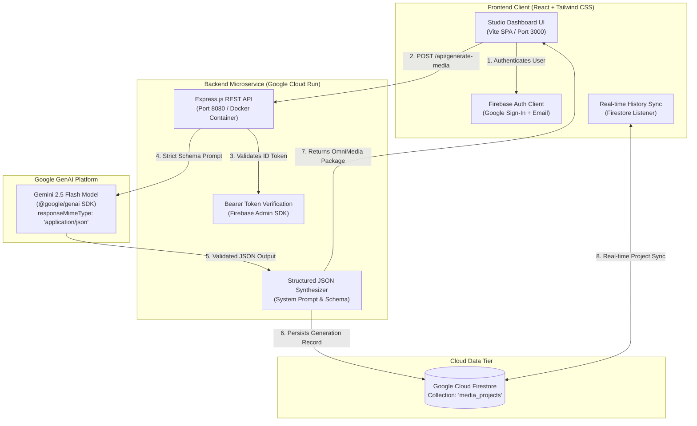

# OmniMedia AI Studio 🎬⚡

> **AI Builder Cup 2026 Hackathon Submission**  
> **Problem Statement:** Media, Content and Digital Experiences  
> **Team:** ByteBound  
> **Autonomous Pre-Production & Omnichannel Media Generation Engine**

[](https://cloud.google.com/run)
[](https://aistudio.google.com/)
[](https://firebase.google.com/)
[](https://react.dev/)
[](https://studio-8239730419-e1c92.web.app)

> 🚀 **Live Demo for Judges:** [https://studio-8239730419-e1c92.web.app](https://studio-8239730419-e1c92.web.app) *(or launch locally in zero-config demo mode)*

---

## 📌 Executive Summary & Brief Description

**OmniMedia AI Studio** is an autonomous pre-production and omnichannel media engine that transforms raw, unstructured, long-form content (meeting notes, podcasts, video transcripts, and keynote addresses) into deterministic, structured digital media packages in seconds.

Instead of human creative teams spending 20+ hours per week manually scrubbing waveforms, extracting hooks, drafting tweets, and formatting blog posts, OmniMedia uses **Gemini 2.5 Flash** with strict JSON schema enforcement to instantly generate:
1. **Timecoded 9:16 Short-Form Video Storyboards** (with spoken audio scripts, visual cues, and on-screen text overlays).
2. **Platform-Tailored Viral Social Threads** (formatted 5-part X/Twitter threads with 280-character constraints + executive LinkedIn posts).
3. **SEO Discovery & Taxonomy** (predicted virality score meter 0–100, target audience demographic, high-intent keywords, and one-click hashtags).
4. **Real-time Generation History** (persisted across sessions via Cloud Firestore).

---

## 🏗️ Google Cloud System Architecture



---

## 🌟 Key Features & Capabilities

| Module | Features & Technical Highlights |
| :--- | :--- |
| **Storyboard Synthesizer** | Generates frame-by-frame 9:16 vertical video beats with exact timecodes (0:00–0:05 hook, pacing, and CTA), director visual cues, and browser SpeechSynthesis voiceover testing. |
| **X (Twitter) Viral Thread** | Generates connected, numbered tweets adhering to 280-character limitations with contrarian hooks and one-click copy buttons. |
| **LinkedIn Executive Post** | Synthesizes thought-leadership reflections with linebreaks, structured bullet points, and industry hashtags. |
| **Virality Index (0-100)** | Algorithmic prediction meter evaluating hook strength, audience resonance, and retention velocity. |
| **Cloud Firestore Persistence** | Automatically syncs project history per user ID with real-time reload and project deletion. |
| **Zero-Config Local Dev Mode** | Built-in high-fidelity dynamic synthetic engine and guest auth bypass so judges can test without requiring external API keys. |

---

## 🚀 Quickstart & Local Development Guide

### Prerequisites
- **Node.js**: v18.0.0 or higher
- **npm**: v9.0.0 or higher

### 1. Clone the Repository
```bash
git clone https://github.com/ByteBound/OmniMedia-AI-Studio.git
cd "OmniMedia AI Studio"
```

### 2. Configure Environment Variables
Copy `.env.example` into both `backend/.env` and `frontend/.env`:

```bash
# Backend configuration
cp .env.example backend/.env

# Frontend configuration
cp .env.example frontend/.env
```

*(Optional)* To use live Gemini 2.5 Flash, add your Gemini API key from [Google AI Studio](https://aistudio.google.com/) into `backend/.env`:
```env
GEMINI_API_KEY=AIzaSyYourLiveGeminiKey
GEMINI_MODEL=gemini-2.5-flash
```
*Note: If no key is set, the studio automatically runs in high-fidelity sandbox mode with instant dynamic synthesis.*

### 3. Install Dependencies
```bash
# Install backend dependencies
cd backend
npm install

# Install frontend dependencies
cd ../frontend
npm install
```

### 4. Start Development Servers
Run the backend and frontend concurrently:

**Terminal 1 (Backend - Port 8080):**
```bash
cd backend
npm start
```
*Check health:* `http://localhost:8080/health`

**Terminal 2 (Frontend - Port 3000 / 3001):**
```bash
cd frontend
npm run dev
```
*Open application:* `http://localhost:3000` (or `http://localhost:3001`)

---

## 🐳 Docker & Google Cloud Run Deployment

### Build & Run Container Locally
```bash
cd backend
docker build -t omnimedia-backend .
docker run -p 8080:8080 -e PORT=8080 omnimedia-backend
```

### Deploy to Google Cloud Run
```bash
# Build and deploy directly to Cloud Run
gcloud run deploy omnimedia-studio-api \
  --source ./backend \
  --platform managed \
  --region us-central1 \
  --allow-unauthenticated \
  --set-env-vars GEMINI_MODEL=gemini-2.5-flash
```

---

## ⏱️ Video Pitch Script Outline (Strict 3-to-4 Minute Structure)

### [0:00 - 0:45] The Hook & Problem Statement
- **Visual:** Split screen showing a creator overwhelmed by timeline cuts in Premiere Pro next to 10 empty draft tabs on Twitter and LinkedIn.
- **Voiceover:** *"In 2026, every brand and creator knows they must publish across TikTok, Reels, Shorts, X, and LinkedIn. But 90% of content dies in raw audio files. High-output teams spend over 20 hours a week manually clipping transcripts, calculating timecodes, and adapting tones. Meet OmniMedia AI Studio: the autonomous omnichannel pre-production engine built for the AI Builder Cup."*

### [0:45 - 1:45] Live Demo: From Transcript to Multi-Asset Package in 3 Seconds
- **Visual:** Screen recording of OmniMedia AI Studio dashboard.
- **Voiceover:** *"Watch this. We paste a raw 45-minute podcast transcript on autonomous AI multi-agent workflows. With one click on 'Generate Omni-Media Assets', our Cloud Run backend leverages Gemini 2.5 Flash with strict JSON schema enforcement."*
- **Visual:** Confetti triggers and the 3 dynamic tabs appear instantly.
- **Voiceover:** *"In 3 seconds, we have an exact 45-second 9:16 video storyboard complete with 0-to-3 second viral hook pacing, spoken narration, visual director cues, and on-screen kinetic text overlays. We can even preview the voiceover pacing directly inside the browser using native speech synthesis."*

### [1:45 - 2:45] Omnichannel Fanout: Social Threads & Virality Taxonomy
- **Visual:** Switching to Tab 2 (Social Threads) and Tab 3 (SEO & Metadata).
- **Voiceover:** *"Next, look at the Social tab: Gemini automatically generated a 5-part X thread strictly bounded to 280 characters, plus an executive thought-leadership article for LinkedIn. In the SEO tab, our algorithmic Virality Gauge scores this transcript at 92/100, breaking down our target audience, high-intent discovery keywords, and platform hashtags."*

### [2:45 - 3:30] Architecture, Cloud Scale & Impact
- **Visual:** Display the Google Cloud Architecture Mermaid flow.
- **Voiceover:** *"OmniMedia AI Studio is architected natively on Google Cloud. The frontend leverages React and Firebase Auth, while our containerized Node.js microservice runs on Google Cloud Run with sub-second autoscaling. Asset history syncs in real-time to Cloud Firestore. By coupling Gemini 2.5 Flash's structured JSON output with Cloud Run, OmniMedia turns days of creative friction into deterministic digital media packages."*

### [3:30 - 4:00] Closing & Call to Action
- **Visual:** Logo animation, GitHub repository link, and team ByteBound credits.
- **Voiceover:** *"OmniMedia AI Studio: Autonomous media engineering for the next generation of digital creators. Built with passion for the AI Builder Cup 2026. Thank you."*

---

## 📋 Hackathon Submission Metadata

- **Project Title:** OmniMedia AI Studio
- **Track / Problem Statement:** Media, Content and Digital Experiences
- **Team Name:** ByteBound
- **Technologies Used:**
  - Google GenAI SDK (`@google/genai`)
  - Gemini 2.5 Flash (`gemini-2.5-flash`)
  - Google Cloud Run (Containerized Microservice)
  - Google Cloud Firestore (Real-time NoSQL storage)
  - Firebase Authentication (Google OAuth + Email)
  - React 18, Vite, Tailwind CSS, Lucide Icons

---

## 📄 License
This project is licensed under the MIT License - see the [LICENSE](LICENSE) file for details.
